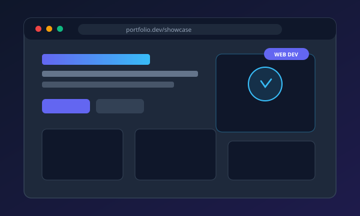

# My Personal Portfolio Website

A modern, responsive, and professional personal portfolio website engineered with clean **HTML5**, **CSS3**, and **modular JavaScript (ES6+)**. Designed to showcase your technical skills, software projects, achievements, learning journey, and unique personality.



---

## 🌟 Key Highlights & Features

- **Modern, Clean & Minimal UI**: High-end glassmorphism styling, clean cards, subtle ambient glows, and balanced whitespace.
- **Dark Mode & Light Mode**: Seamless theme switching with saved preference in `localStorage`.
- **Single-File Configuration (`js/config.js`)**: All personal information, skills, projects, favourite things, timeline, certificates, and contact links live in one clean, well-commented file. No need to touch HTML!
- **Section 1: Hero Landing**: Profile photo avatar, customizable headline, typewriter animation looping through your titles, quick social badges, and 3 primary call-to-action buttons ("Explore My Work", "Contact Me", "Download My Resume").
- **Section 2: About Me**: Authentic personal introduction, background narrative, and quick-highlight cards (Education, Core Focus, Professional Goals, Motivations).
- **Section 3: Categorized Skills**:
  - **Programming**: Python, C, C++
  - **Web Development**: HTML, CSS, JavaScript
  - **Database**: MySQL
  - **Tools**: VS Code, Git, GitHub, Wireshark
- **Section 4: Project Showcase**: Interactive category filtering (**All**, **Web Development**, **Programming**, **Cybersecurity**, **Other Projects**), technology badges, interactive demo modal, and direct GitHub links.
- **Section 5: My Favourite Things**: 10 dedicated personality cards:
  1. Favourite Colour
  2. Favourite Movie
  3. Favourite Web Series
  4. Favourite Music
  5. Favourite Food
  6. Favourite Place
  7. Favourite Hobby
  8. Favourite Technology
  9. Favourite Sport
  10. Favourite Quote
- **Section 6: My Journey**: Modern vertical timeline detailing your education, technical milestones, and personal development.
- **Section 7: Certifications & Achievements**: Accredited credentials, hackathon honors, and verification IDs with certificate viewer links.
- **Section 8: Currently Learning**: Real-time status badges (*In Progress*, *Exploring*, *Next Step*) showcasing ongoing growth.
- **Section 9: Lead Generation Contact Form**:
  - Full Name, Email, Subject, Enquiry Type dropdown (*Job Opportunities*, *Freelance Projects*, *Collaboration*, *General Enquiry*), and Message.
  - Client-side validation (prevents empty submissions, validates email format).
  - Ready for 1-click **Formspree** email integration.
- **Section 10: Professional Footer**: Tagline, quick links, dynamic copyright year (`new Date().getFullYear()`), and smooth **Back-to-Top** button.
- **Zero Build Tools / Zero Dependencies**: Pure standards-compliant code. Runs natively in any browser without npm or complex setups.

---

## 📁 Project Structure

```text
mywebsite/
├── index.html                   # Main semantic HTML5 document with SEO meta tags
├── README.md                    # Documentation & customization guide
├── css/
│   ├── style.css                # CSS variables, dark/light themes, typography & layout
│   └── animations.css           # Keyframes, hover micro-interactions, scroll reveal
├── js/
│   ├── config.js                # ⚡ EDIT HERE: All personal details, data & links
│   ├── data-renderer.js         # Dynamically populates HTML from config.js
│   └── main.js                  # Theme switcher, typewriter, form validation, modals
└── assets/
    ├── favicon.svg              # Crisp high-tech SVG favicon
    ├── resume/
    │   └── sample-resume.pdf    # Downloadable resume file
    └── images/
        ├── avatar-placeholder.svg
        ├── projects/            # Vector preview mockups for project cards
        │   ├── web-portfolio.svg
        │   ├── packet-analyzer.svg
        │   ├── algorithm-visualizer.svg
        │   ├── db-management.svg
        │   ├── cli-system.svg
        │   └── security-prototype.svg
        └── certs/               # Certificate preview badges
            ├── cert-python.svg
            ├── cert-web.svg
            ├── cert-database.svg
            └── cert-achievement.svg
```

---

## 🚀 How to Run the Website Locally

You can run this website using any of the following methods:

### Method 1: Direct File Launch
Double-click `index.html` in your file explorer. It will open immediately in your default web browser (Chrome, Edge, Firefox, Safari).

### Method 2: Python HTTP Server (Recommended)
Open PowerShell or Terminal in the project folder and run:
```powershell
python -m http.server 8000
```
Then visit **`http://localhost:8000`** in your browser.

### Method 3: VS Code Live Server
If you use VS Code:
1. Open the `mywebsite` folder in VS Code.
2. Right-click `index.html` and choose **"Open with Live Server"**.

---

## 🛠️ Step-by-Step Customization Guide

All personal configuration is stored in **[`js/config.js`](js/config.js)**. Simply open `js/config.js` in any text editor (such as VS Code or Notepad) and update the values.

### 1. Updating Your Name, Bio & Headline
Open `js/config.js` and locate the `personal` object:
```javascript
personal: {
  fullName: "Your Name Here",
  headlinePrefix: "Hello, I'm",
  headlineSubtitle: "An aspiring developer, creative thinker and technology enthusiast.",
  heroDescription: "Your personalized introduction...",
  typingRoles: [
    "Developer",
    "Technology Enthusiast",
    "Creative Thinker",
    "Lifelong Learner"
  ],
  email: "you@example.com",
  github: "https://github.com/yourusername",
  linkedin: "https://linkedin.com/in/yourusername"
}
```

### 2. Replacing Your Profile Picture
1. Save your photo (e.g. `profile.jpg` or `profile.png`) into the `assets/images/` directory.
2. In `js/config.js`, update:
   ```javascript
   avatar: "assets/images/profile.jpg",
   ```

### 3. Updating Your Resume
1. Export your resume as a PDF (e.g. `My_Resume.pdf`).
2. Place it into `assets/resume/`.
3. In `js/config.js`, update:
   ```javascript
   resumeUrl: "assets/resume/My_Resume.pdf",
   ```

### 4. Updating Your "Favourite Things" (10 Items)
In `js/config.js`, scroll to `favourites.items`. Replace the placeholders with your real preferences:
```javascript
{
  id: "fav-colour",
  title: "Favourite Colour",
  icon: "fa-solid fa-palette",
  accent: "#6366f1",
  selection: "Deep Emerald Green",
  description: "Reflects clarity, focus, and a modern aesthetic."
},
{
  id: "fav-movie",
  title: "Favourite Movie",
  icon: "fa-solid fa-film",
  accent: "#ec4899",
  selection: "Interstellar",
  description: "Fascinating narrative exploring science, time, and human determination."
}
// Repeat for Web Series, Music, Food, Place, Hobby, Technology, Sport, Quote!
```

### 5. Adding or Editing Projects
In `js/config.js`, locate `projects.list`. To add a new project, add an entry to the array:
```javascript
{
  id: "proj-my-new-app",
  title: "My Awesome Web App",
  category: "Web Development", // Or "Programming", "Cybersecurity", "Other Projects"
  image: "assets/images/projects/web-portfolio.svg",
  description: "A short, engaging description of what your project accomplishes.",
  technologies: ["JavaScript", "HTML5", "CSS3", "API"],
  demoUrl: "https://your-live-demo.com", // Set to "#" if no live link yet
  githubUrl: "https://github.com/yourusername/repo-name",
  featured: true
}
```

### 6. Adding Certifications & Achievements
In `js/config.js`, locate `certifications.list`:
```javascript
{
  title: "Python Programming Specialization",
  issuer: "Coursera / Python Institute",
  date: "2024",
  credentialId: "PYT-9824-CS",
  image: "assets/images/certs/cert-python.svg",
  skills: ["Python", "OOP", "Data Structures"],
  pdfLink: "assets/images/certs/cert-python.svg",
  type: "Online Course"
}
```

---

## 📬 Connecting the Contact Form to Receive Real Emails (Formspree)

By default, the contact form validates all fields and displays a safe test notification. To receive real messages straight to your email:

1. Go to **[https://formspree.io](https://formspree.io)** and create a free account.
2. Click **"+ New Form"**, give it a name (e.g. "Portfolio Contact Form"), and copy your Form endpoint URL. It will look like:
   `https://formspree.io/f/mqkenwza`
3. Open `js/config.js`, find `contact.formspreeEndpoint`, and paste your URL:
   ```javascript
   contact: {
     formspreeEndpoint: "https://formspree.io/f/mqkenwza",
     // ...
   }
   ```
4. Save the file. Your form will now send submitted messages directly to your email inbox!

---

## 🌐 How to Deploy Your Portfolio Online for Free

### Option A: GitHub Pages (Recommended - 100% Free Forever)
1. Create a GitHub account at [github.com](https://github.com) if you haven't already.
2. Create a new repository named `<your-username>.github.io` (or any repository name like `portfolio`).
3. Push your `mywebsite` files to the repository:
   ```bash
   git init
   git add .
   git commit -m "Initial portfolio release"
   git branch -M main
   git remote add origin https://github.com/<your-username>/<your-repo>.git
   git push -u origin main
   ```
4. In your GitHub repository:
   - Go to **Settings** → **Pages**
   - Under **Build and deployment > Branch**, select `main` and root (`/`), then click **Save**.
5. Your website will be live in 1-2 minutes at:
   `https://<your-username>.github.io`

### Option B: Netlify (Drag & Drop - 30 Seconds)
1. Go to **[https://www.netlify.com](https://www.netlify.com)** and log in.
2. Go to **Sites** and drag the entire `mywebsite` folder directly into the Netlify dashboard.
3. Your portfolio goes live instantly with a free SSL certificate and custom domain options.

### Option C: Vercel
1. Go to **[https://vercel.com](https://vercel.com)**.
2. Import your GitHub repository or use the Vercel CLI.
3. Click **Deploy**.

---

## 🎨 Technology Stack

- **HTML5**: Semantic tags (`<header>`, `<main>`, `<section>`, `<article>`, `<footer>`, `<aside>`) for accessibility and search engine optimization.
- **CSS3**: CSS Custom Properties (Variables), Flexbox, CSS Grid, Glassmorphism (`backdrop-filter`), and CSS Keyframe animations.
- **JavaScript (Vanilla ES6+)**: IntersectionObserver for scroll-reveal animations, responsive mobile drawer, dynamic typewriter effect, client-side form validation, and decoupled configuration rendering.
- **Icons**: Font Awesome 6 CDN.
- **Typography**: Google Fonts (*Plus Jakarta Sans*, *Outfit*, and *JetBrains Mono*).

---

## 📄 License
This project is open-source and free to use for personal and commercial portfolio purposes.
